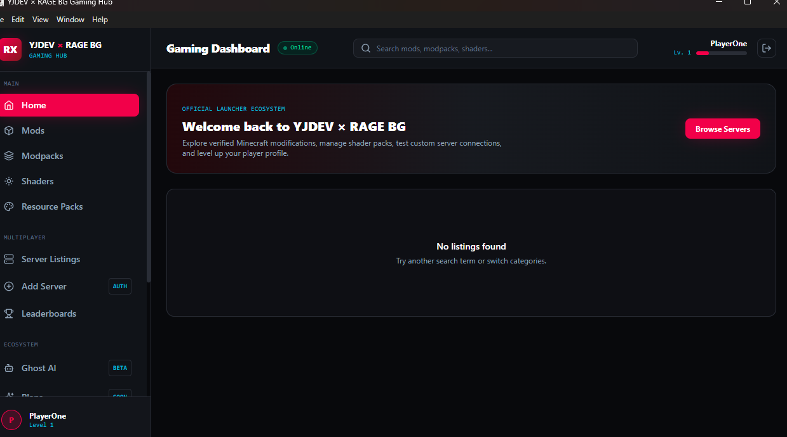
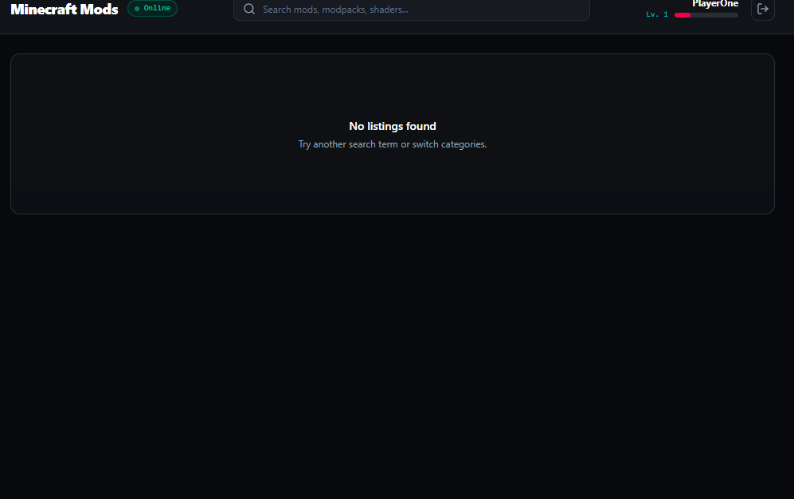
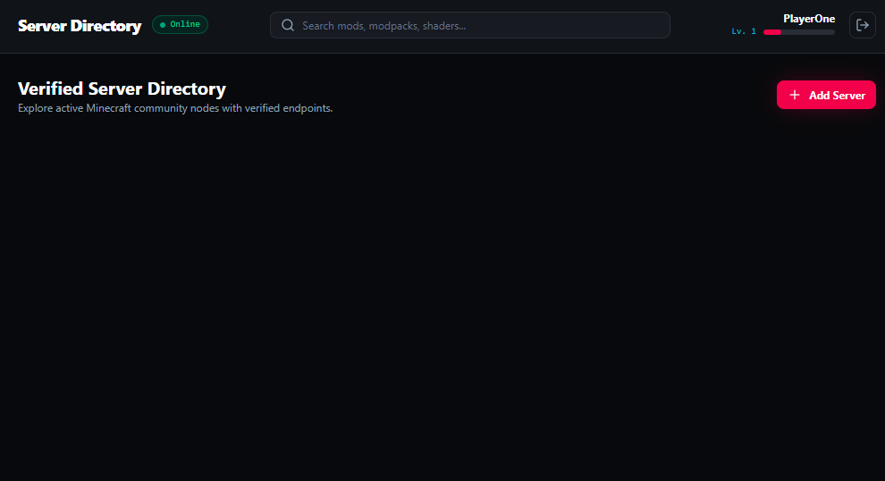

# 🎮 YJDEV × RAGE BG Gaming Hub

<div align="center">

# 🔥 YOUR GAMING. YOUR MODS. YOUR COMMUNITY.

**One hub. Endless possibilities.**

A Minecraft-first gaming hub by **YJDEV STUDIOS × RAGE BG**, bringing gaming customization, server discovery, and community features into one desktop experience.

[](https://github.com/YUVRAJ35/YJDEV-X-RAGEBG-DOWNLOAD/commits/Versions)
[](https://www.microsoft.com/windows)
[](https://www.electronjs.org/)
[](https://github.com/YUVRAJ35/YJDEV-X-RAGEBG-DOWNLOAD/commits/Versions)

### ⬇️ GET THE GAMING HUB

**[🌐 OFFICIAL WEBSITE](https://yjdevgaminghub.vercel.app/)** · **[📦 VERSION HISTORY](https://github.com/YUVRAJ35/YJDEV-X-RAGEBG-DOWNLOAD/commits/Versions)** · **[💬 JOIN DISCORD](https://discord.gg/NEHBEND84a)**

</div>

---

## 🩸 About the Project

**YJDEV × RAGE BG Gaming Hub** is a Windows desktop application designed to make gaming content easier to discover and access.

From Minecraft mods and modpacks to shaders, resource packs, and community server listings, the goal is to bring useful gaming resources together in one place.

Built under the **YJDEV STUDIOS × RAGE BG** identity, the project is evolving through beta releases, feature improvements, and community feedback.

> ⚠️ **Early Beta Notice**
>
> This project is actively being developed. Some features may be incomplete, experimental, or temporarily unavailable. Check the release notes for the latest changes and known issues.

---

## ⚔️ Features

| Feature | Description |
|:--|:--|
| 🏠 **Home Dashboard** | A central starting point for the Gaming Hub. |
| 🧩 **Mods** | Discover gaming modifications. |
| 📦 **Modpacks** | Explore modpack collections. |
| 🌈 **Shaders** | Browse shader packs. |
| 🎨 **Resource Packs** | Find Minecraft customization resources. |
| 🌐 **Server Listings** | Browse community servers and access server submission features. |
| 🏆 **Leaderboards** | Explore available player and server rankings. |
| 👤 **Accounts** | Login and registration interface. |
| 👻 **Ghost AI** | An experimental in-app assistant. |
| 💎 **Plans** | Preview planned membership tiers. |
| 🔗 **Community Hub** | Access official project websites and social channels. |

*The presence of a feature in the interface does not guarantee that every related function is fully operational in this beta.*

---

## 🖥️ Screenshots

<div align="center">

### 🏠 Home Dashboard



### 🧩 Mods & Modpacks



### 🌐 Server Listings



</div>

---

## 📥 Download & Installation

<div align="center">

### Ready to enter the Hub?

**[🌐 VISIT THE OFFICIAL DOWNLOAD WEBSITE](https://yjdevgaminghub.vercel.app/)**

</div>

1. Visit the official Gaming Hub website.
2. Download the latest available Windows installer or portable build.
3. For the installer, open the downloaded `.exe` file.
4. Follow the installation instructions.
5. Launch **YJDEV × RAGE BG Gaming Hub**.

You can also check the [GitHub version history](https://github.com/YUVRAJ35/YJDEV-X-RAGEBG-DOWNLOAD/commits/Versions) for project updates.

**Security:** Download application files only from official project sources. Verify the source before running an executable.

---

## 🛠️ Built With

| Technology | Purpose |
|:--|:--|
| ⚡ **Electron** | Windows desktop application framework |
| ⚛️ **React** | User interface |
| 🚀 **Vite** | Web development and build tooling |
| 📘 **TypeScript** | Type-safe application development |
| 🟢 **Node.js** | JavaScript runtime |
| 🗄️ **SQLite** | Local database storage for supported features |

*The technology stack may change as the project evolves.*

---

## 💻 Development Setup

Want to run the source project locally?

### Requirements

- [Node.js](https://nodejs.org/)
- npm
- [Git](https://git-scm.com/)
- Windows for testing the Windows desktop application

### Getting Started

Run the following commands from the **application source-code repository**:

```bash
git clone YOUR_SOURCE_REPOSITORY_URL
cd yjdev-gaming-hub
npm install
npm run dev:all
```

> **Important:** Replace `YOUR_SOURCE_REPOSITORY_URL` with the actual source repository URL. The public download repository may contain release files rather than the complete source code. The development commands require the source-code monorepo.

---

## 🗺️ Development Roadmap

The Gaming Hub will continue evolving through testing, feedback, and future releases.

- [ ] Improve mod and modpack discovery.
- [ ] Improve shader and resource-pack listings.
- [ ] Resolve server-listing and production API issues.
- [ ] Improve account and profile functionality.
- [ ] Expand Ghost AI capabilities.
- [ ] Improve error handling and application stability.
- [ ] Continue testing portable and installer builds.
- [ ] Explore additional gaming integrations.
- [ ] Improve documentation and community support.

*This roadmap represents development goals, not guaranteed release dates.*

---

## 🐛 Report Bugs & Share Feedback

Found an issue? Your feedback can help improve the Gaming Hub.

When reporting a bug, please include:

- **Application version:** For example, `0.1.0`
- **Operating system:** Your Windows version
- **Steps to reproduce:** What you did before the issue appeared
- **Expected behavior:** What you thought would happen
- **Actual behavior:** What happened instead
- **Evidence:** A screenshot or error message, if available

Please don't post passwords, API keys, access tokens, or other private information in public reports.

---

## 🌐 Official Links

<div align="center">

| Platform | Link |
|:--|:--|
| 🌍 Gaming Hub Website | [yjdevgaminghub.vercel.app](https://yjdevgaminghub.vercel.app/) |
| 🖼️ YJDEV Wallpapers | [yjdev-wallpapers.vercel.app](https://yjdev-wallpapers.vercel.app/) |
| 🎥 RAGE BG | [YouTube Channel](https://www.youtube.com/@RAGEBGOFFICAL) |
| 🎬 YJDEV STUDIOS | [YouTube Channel](https://www.youtube.com/@YJDEVSTUDIOSOFFICAL) |
| 💬 Discord | [Join the Community](https://discord.gg/NEHBEND84a) |
| 📦 Version History | [GitHub](https://github.com/YUVRAJ35/YJDEV-X-RAGEBG-DOWNLOAD/commits/Versions) |

</div>

---

## 👑 Credits & Vision

**Created by YJDEV STUDIOS × RAGE BG**

Built with a vision to bring gaming customization, discovery, and community together in one convenient desktop hub.

Every release is another step toward that vision.

<div align="center">

# 🔥 PLAY. DOMINATE. LEAVE A LEGACY. 🔥

**YJDEV × RAGE BG Gaming Hub**

*Discover more. Customize more. Game your way.*

</div>

